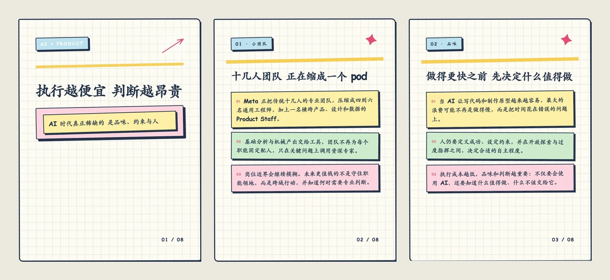
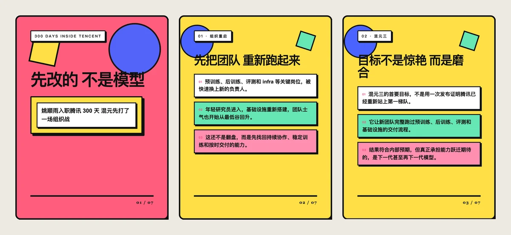
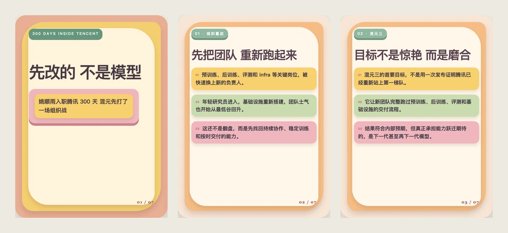
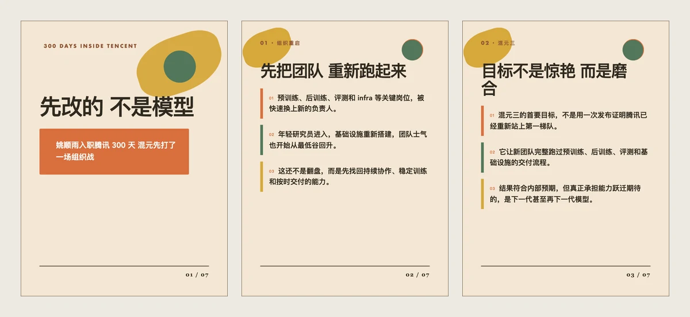
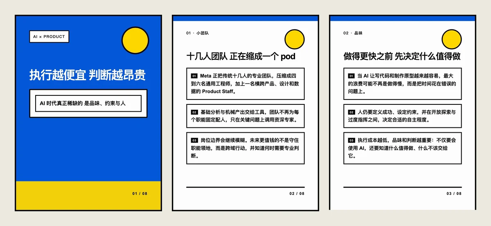
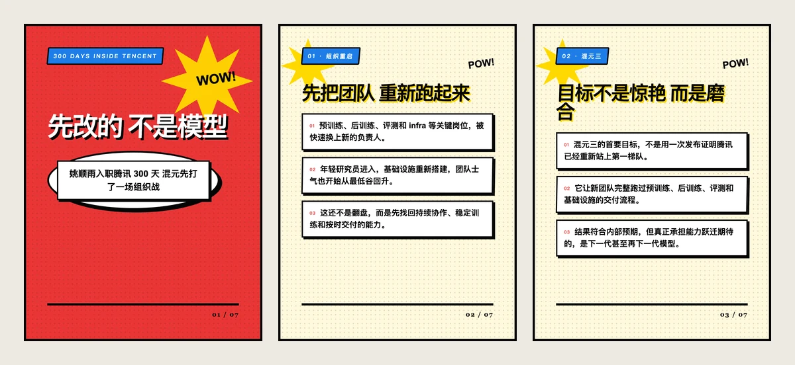
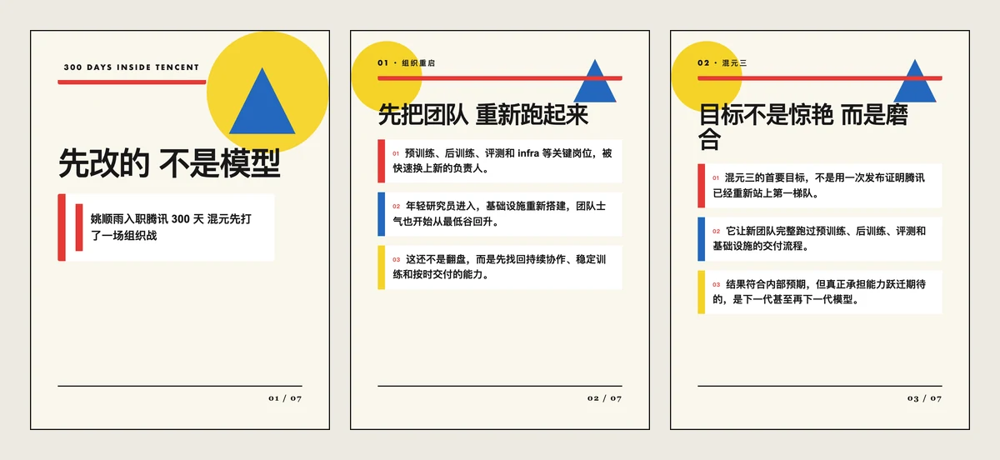
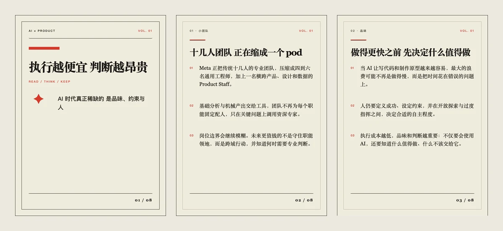
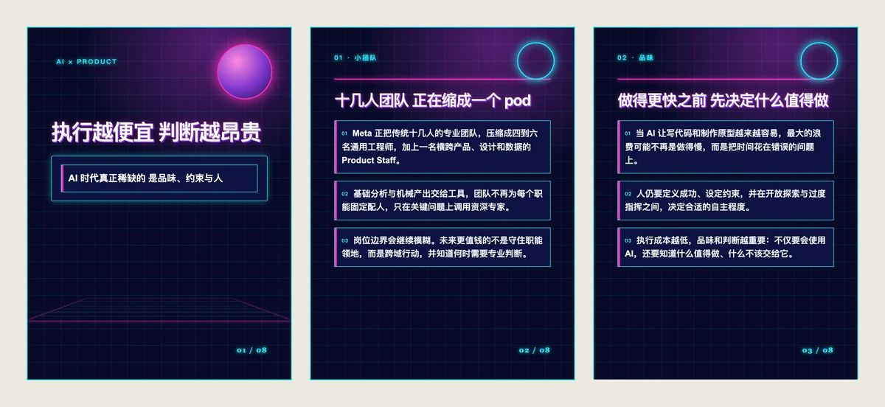
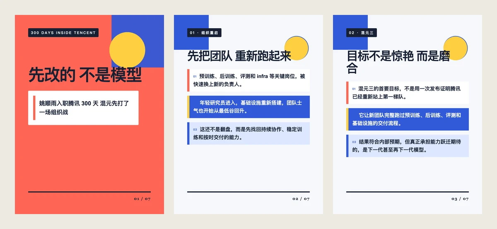

# PennyScribe Skills

一组基于 [PennyScribe](https://pennyscribe.com) 的开源 Agent Skills，帮助你把播客和视频整理成更适合阅读、收藏和发布的内容。

**在线 Demo：[https://pennyscribe-skills-demo.pages.dev](https://pennyscribe-skills-demo.pages.dev)**

Demo 使用一集公开播客展示完整效果，无需 API Key。你可以查看分段全文、摘要、金句、X 素材和小红书卡片，并切换 10 种卡片风格。页面修改只保留在当前浏览器中，不会写回服务器。

目前包含：

- [`repurpose-podcast`](skills/repurpose-podcast)：输入一个公开播客或视频链接，生成分段全文、摘要、金句、X 文案、小红书文案和可导出的图片卡片。

## `repurpose-podcast` 能做什么？

你只需要给智能体一个节目链接，它会完成下面这些工作：

1. 提取节目标题、作者、封面等信息，并检查 YouTube 原语言字幕。
2. YouTube 优先使用原语言人工字幕，没有人工字幕时使用原语言自动字幕；没有可用字幕的内容才下载音频并使用 PennyScribe 转写。
3. 保留完整内容，整理成分好章节和段落的阅读版全文。
4. 生成节目摘要、核心观点、适合人群和金句列表。
5. 分别生成适合 X 和小红书的发布素材。
6. 生成一个可以在浏览器中编辑和预览的本地网站。
7. 将小红书卡片复制为图片、单张导出为 PNG，或全部打包成 ZIP。

### 支持的内容来源

| 来源 | 示例 |
| --- | --- |
| YouTube | 单个公开视频链接 |
| Apple Podcasts | 单集节目链接 |
| 小宇宙 | 单集节目链接 |
| Bilibili | 单个公开视频链接 |
| RSS / 直接音频 | RSS 中的公开音频地址、MP3 等 |
| 本地文件 | 本机上的音频或视频文件 |

只支持可以公开访问的单集内容。Skill 不会绕过登录、付费墙、DRM、地区限制或平台访问控制。

## 快速开始

### 第一步：下载并加载 Skill

这个 Skill 不绑定特定智能体。Claude Code、WorkBuddy，以及其他能够读取 `SKILL.md`、执行 Python 和命令行工具的智能体都可以使用。

先下载仓库：

```bash
git clone https://github.com/YeDaxia/pennyscribe-skills.git
```

然后把下面的提示词发给你的智能体，并根据实际位置修改路径：

> 请读取 `pennyscribe-skills/skills/repurpose-podcast/SKILL.md`，并使用这个 Skill 处理我接下来提供的节目链接。

如果你的智能体原生支持 Agent Skills，也可以把整个 `repurpose-podcast` 目录复制到该产品文档指定的用户级或项目级 Skills 目录。不同产品的目录位置并不相同，请以对应产品的说明为准；不要只复制 `SKILL.md`，`scripts`、`references` 和 `assets` 目录也需要保留。

### 第二步：安装必要工具

Skill 需要以下命令：

- Python 3
- `yt-dlp`
- `ffmpeg`
- `curl`

macOS：

```bash
brew install python yt-dlp ffmpeg
```

Ubuntu / Debian：

```bash
sudo apt update
sudo apt install -y python3 ffmpeg curl
python3 -m pip install -U yt-dlp
```

Windows PowerShell：

```powershell
winget install Python.Python.3.12
winget install yt-dlp.yt-dlp
winget install Gyan.FFmpeg
```

现代 Windows 通常已经自带 `curl`。安装完成后如果智能体仍然找不到命令，请重新打开终端，或者重启正在使用的智能体应用。

macOS / Linux 可以用下面的命令确认安装成功：

```bash
python3 --version
yt-dlp --version
ffmpeg -version
curl --version
```

Windows PowerShell 使用：

```powershell
python --version
yt-dlp --version
ffmpeg -version
curl --version
```

四条命令都能输出版本信息后，再继续下一步。

### 第三步：设置 PennyScribe API Key

如果 YouTube 视频包含可用的原语言字幕，这一步可以跳过。其他平台或没有可用字幕的 YouTube 视频仍需要使用 PennyScribe 转写。

登录 [PennyScribe](https://pennyscribe.com) 创建 API Key。推荐把它设置成当前用户的持久环境变量：设置后当前终端立即生效，关闭终端或重启电脑后也不会消失。

macOS（默认 zsh）：

```bash
read -s "PENNYSCRIBE_API_KEY?请输入 PennyScribe API Key："
echo
export PENNYSCRIBE_API_KEY
printf '\nexport PENNYSCRIBE_API_KEY=%q\n' "$PENNYSCRIBE_API_KEY" >> ~/.zshrc
```

Linux（默认 bash）：

```bash
read -rsp "请输入 PennyScribe API Key：" PENNYSCRIBE_API_KEY
echo
export PENNYSCRIBE_API_KEY
printf '\nexport PENNYSCRIBE_API_KEY=%q\n' "$PENNYSCRIBE_API_KEY" >> ~/.bashrc
```

Windows PowerShell：

```powershell
$secureKey = Read-Host "请输入 PennyScribe API Key" -AsSecureString
$apiKey = [System.Net.NetworkCredential]::new("", $secureKey).Password
[Environment]::SetEnvironmentVariable("PENNYSCRIBE_API_KEY", $apiKey, "User")
$env:PENNYSCRIBE_API_KEY = $apiKey
Remove-Variable apiKey, secureKey
```

以上命令不会在输入时显示 API Key。它们既设置当前会话，也写入当前用户的持久配置，不需要管理员权限。

可以用下面的命令确认变量已经存在；命令只显示“已生效”，不会打印 Key：

macOS / Linux：

```bash
test -n "$PENNYSCRIBE_API_KEY" && echo "已生效" || echo "未生效"
```

Windows PowerShell：

```powershell
if ($env:PENNYSCRIBE_API_KEY) { "已生效" } else { "未生效" }
```

已经运行的智能体应用无法自动收到新环境变量，首次设置后需要重启一次应用。之后每次重新登录或重启电脑，配置仍然有效。请不要把 API Key 粘贴到聊天中，也不要写入 `project.json`、README 或提交到 GitHub。

### 第四步：让智能体处理节目

把下面的示例提示词发给你的智能体，并替换节目链接：

> 请使用 `repurpose-podcast` 处理这个播客：`https://example.com/episode`。保留适合阅读的完整全文，并生成摘要、金句、X 文案、小红书标题、发布文案和图片卡片。最后生成本地预览网站。

你也可以继续告诉智能体你的偏好，例如：

> 小红书卡片使用“手绘涂鸦”风格，标题更偏向职场人群，正文不要使用夸张表达。

> 把这期节目加入之前生成的播客网站，让我可以切换查看不同节目。

## 生成的网站怎么使用？

网站包含五个主要页面：

| 页面 | 用途 |
| --- | --- |
| 导读与摘要 | 快速了解节目主题、摘要、核心观点和适合人群 |
| 金句 | 查看、编辑和复制节目中的重点表达 |
| 阅读全文 | 阅读经过分段和章节整理的完整转写 |
| X 素材 | 复制带原节目链接的单条文案或 Thread |
| 小红书素材 | 编辑标题、无链接发布文案和图片卡片 |

页面中的主要文字都可以直接点击编辑。编辑完成后，可以通过顶部的“导出项目 JSON”保存修改后的结构化内容。

### 小红书卡片操作

进入“小红书素材 → 卡片编辑”后，你可以：

- 切换 10 种卡片风格。
- 使用左右箭头调整卡片顺序。
- 点击“复制文字”复制当前卡片里的文字。
- 点击“导出 PNG”下载当前卡片的 1080×1440 图片。
- 点击“复制卡片”把当前 PNG 图片写入系统剪贴板，可直接粘贴到支持图片的应用。
- 点击“导出全部卡片”下载一个包含全部 PNG 的 ZIP 文件。
- 点击“删除”移除不需要的卡片。

“复制卡片”需要通过本地网站地址访问，例如 `http://127.0.0.1:8000/`。如果直接双击打开 HTML 文件，浏览器可能会因为安全限制拒绝访问图片剪贴板。

### 内置卡片风格

下面每张预览图都使用在线 Demo 的前三张卡片生成，展示同一组内容在不同设计语言下的实际效果。

<table>
  <tr>
    <td width="50%"><strong>1. 手绘涂鸦</strong><br></td>
    <td width="50%"><strong>2. 新粗野主义</strong><br></td>
  </tr>
  <tr>
    <td><strong>3. 剪纸风格</strong><br></td>
    <td><strong>4. 中世纪现代</strong><br></td>
  </tr>
  <tr>
    <td><strong>5. 无障碍设计</strong><br></td>
    <td><strong>6. 漫画书</strong><br></td>
  </tr>
  <tr>
    <td><strong>7. 包豪斯</strong><br></td>
    <td><strong>8. 杂志排版</strong><br></td>
  </tr>
  <tr>
    <td><strong>9. 复古未来主义</strong><br></td>
    <td><strong>10. 扁平风格</strong><br></td>
  </tr>
</table>

封面卡和内容卡使用不同的构图；内容卡默认采用三段式结构，让核心结论、事实背景和进一步影响都能独立呈现。

## 输出文件

每个节目通常会生成类似下面的目录：

```text
episode-project/
├── source/
│   ├── transcript.txt     # YouTube 存在原语言字幕时生成
│   ├── media.mp3          # 没有可用字幕时生成
│   └── metadata.json      # 节目信息
├── project.json           # 全文、摘要和社交素材
├── index.html             # 可编辑的单集网页
└── exports/
    └── xiaohongshu/       # 导出的卡片 PNG
```

如果生成了多期节目，Skill 还可以创建一个 `podcast-library` 本地网站，通过左侧列表切换节目。

## 常见问题

### 为什么链接下载失败？

请先确认链接是公开的单集页面，而不是播放列表、登录后页面或受 DRM 保护的内容。你也可以提供：

- 公开 RSS 地址
- 直接音频地址
- 已下载到本机的音频文件

不要把浏览器 Cookie 提交到仓库。只有在你明确授权后，Skill 才应该临时使用本机浏览器 Cookie。

### 为什么“复制卡片”失败？

请使用 Skill 启动的 `http://127.0.0.1:8000/` 本地网站，并在浏览器询问时允许剪贴板权限。部分浏览器可能不支持写入图片剪贴板，此时仍可使用“导出 PNG”。

### 为什么转写需要较长时间？

包含原语言字幕的 YouTube 视频会直接提取字幕，不需要等待 PennyScribe。Skill 会优先选择人工字幕，其次选择同语言自动字幕，并排除翻译字幕。

没有可用字幕时，节目需要先下载、转换、上传，再等待 PennyScribe 完成转写。耗时会受到节目长度、文件大小和网络状况影响。

### 小红书文案为什么不带节目链接？

这是有意设计：X 文案会保留播客链接；小红书标题、文案和卡片不写入链接，更适合平台内发布。原始链接仍保留在项目元数据和导读页面中。

### 能否修改生成结果？

可以。网页里的全文、摘要、金句、社交文案和卡片文字都支持编辑。建议修改后导出新的项目 JSON，避免重新生成时覆盖你的编辑。

## 给开发者

仓库结构：

```text
skills/repurpose-podcast/
├── SKILL.md
├── assets/
├── references/
└── scripts/
```

运行测试：

```bash
python3 -m unittest tests.test_skill_scripts
```

命令行批量导出卡片需要 Node.js、Playwright 和 Chromium：

```bash
node skills/repurpose-podcast/scripts/export_cards.cjs \
  /path/to/project/index.html \
  --output-dir /path/to/project/exports/xiaohongshu
```

欢迎提交 Issue、Pull Request 或新的 PennyScribe Skill。

## 安全与隐私

- API Key 只保存在本机环境变量中。
- 只有需要 PennyScribe 转写时，音频才会上传。YouTube 字幕提取路径不会上传音频。
- 不要提交 Cookie、音频文件或包含私人内容的项目文件。
- 只处理你有权访问和使用的内容。
- 本地预览服务器默认只监听 `127.0.0.1`，不会自动暴露到公网。

## License

[Apache-2.0](LICENSE)
